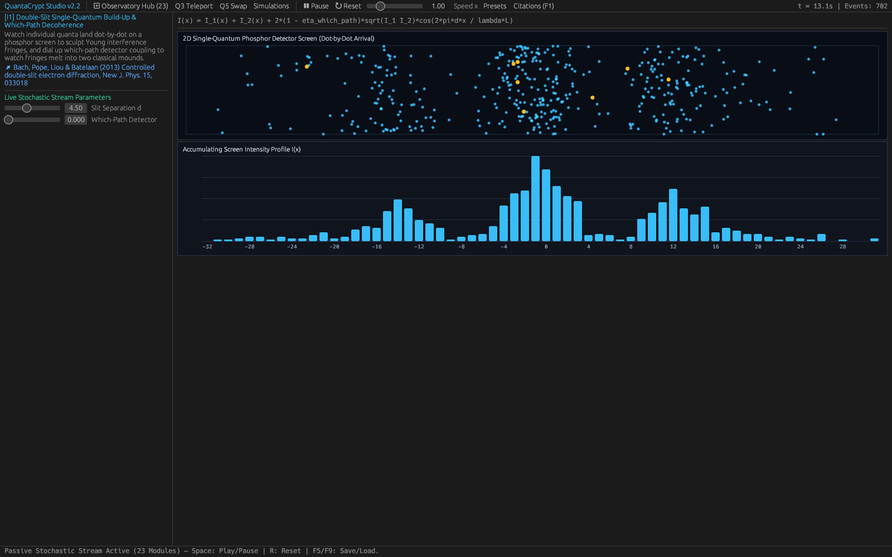

# QuantaCrypt Studio (`quantacrypt-studio` v2.2.0)



**QuantaCrypt Studio (`v2.2.0`)** is a zero-unsafe (`#![forbid(unsafe_code)]` library, `#![deny(unsafe_code)]` desktop shell outside Windows console attach), native safe-Rust **23-module passive stochastic quantum and post-quantum cryptography observatory** (`eframe` / `egui` `0.31`) paired with a headless CLI (`clap`), SQLite WAL workset persistence (`rusqlite`), OpenQASM 2.0 circuit simulator, and interactive custom renderers.

- **License**: GNU General Public License v3.0 or later (`GPL-3.0-or-later`)
- **Zenodo DOI**: [`10.5281/zenodo.24244089`](https://doi.org/10.5281/zenodo.24244089) (`APP-PREPRINT-16`)
- **Web Hub**: [https://crvscience.com/apps](https://crvscience.com/apps)

## Highlights Across the 4 Upgrade Pillars

1. **Usability & Curriculum Navigation**:
   - Keyboard navigation guarded by `!ctx.wants_keyboard_input()`: `Left`/`Right` cycle through all 23 modules, `H` toggles Observatory Hub vs. Module Workspace, `Space` pauses/resumes, `R` resets the stochastic stream, `F1` opens shortcuts/citations, `F5`/`F9` quick-save/load SQLite slots, and `Esc` dismisses open modals before returning to the Hub.
   - Live module search/filter in both the **Simulations** menu and **Observatory Hub**, top-bar quick group filter pills (`I`, `Q`, `D`, `K`, `C`, `A`), equation/unit hover tooltips across parameter sliders, and 1-click regime presets across key modules (`I1`, `Q4`, `K1`, `C3`, `C4`, `A1`, `A2`, `A3`, `A4`).
2. **Scientific & Cryptographic Rigor**:
   - **QAOA Max-Cut (`A3`)**: Full `11`-bin cut histogram (`0..=10`) so optimal `C_max = 10` samples (e.g., bitmask `0b0101_1010`) record cleanly in bin `10` without truncation.
   - **FIPS 203 ML-KEM (`C3`)**: Exact rejection sampling for uniform `R_q` (`q = 3329`), distinct FIPS 203 Table 2 `(eta_1 = 3, eta_2 = 2)` parameters on `ML-KEM-512`, `Compress_{d_u,d_v}` / `Decompress_{d_u,d_v}` ciphertext quantization noise, and Fujisaki-Okamoto (FO) re-encapsulation / implicit rejection telemetry.
   - **FIPS 204 ML-DSA (`C4`)**: Signed sparse challenge vector `c in {-1, 0, +1}^n` of exact Hamming weight `tau` via negacyclic convolution `z = y + c*s` in both the CLI lab and live arena.
   - **BB84 QKD (`K1`)**: Explicit Cascade parity leakage `leaked_parity_bits` + phase entropy subtraction during Toeplitz universal-2 privacy amplification (`final_amplified_key_bits <= sifted_len - leaked_parity_bits`).
3. **2D / 3D Canvas Fidelity**:
   - **3D Bloch Sphere Cloud**: True camera depth sorting back-to-front, solid front / dimmed-dashed back great circles, directional 3D vector arrowheads, and double-click camera reset.
   - **Density-Matrix Heatmap**: Right-margin circular phase colorwheel (`arg(rho_ij)`) paired with a `0.0 -> 1.0` magnitude bar (`|rho_ij|`).
   - **Rotated Surface-Code Lattice**: Boundary weight-2 half-plaquettes (`Z` top/bottom, `X` left/right) for complete `n^2 - 1` commuting stabilizers (`[[9,1,3]]`, `[[25,1,5]]`, `[[49,1,7]]`) plus compact legend.
   - **Rydberg QAOA Graph & Scientific Plots**: Live cut counter + spin/cut legend on QAOA graphs, and interactive crosshair + coordinate readout overlay inside scientific time-series plots.

## Controls & Hotkeys

| Input | Action | Notes |
| --- | --- | --- |
| `Left` / `Right` | Previous / Next module | Cycles across all 23 modules in order |
| `H` | Toggle Observatory Hub | Switches Hub <-> Module Workspace |
| `Space` | Play / Pause stream | Guards active text inputs (`!wants_keyboard_input`) |
| `R` | Reset live stochastic stream | Restores deterministic seed state for active module |
| `F1` | Toggle Shortcuts & Citations | Lists all 23 primary literature DOIs |
| `F5` / `F9` | Quick Save / Quick Load | Uses bundled/selected SQLite WAL workset DB |
| `Esc` | Dismiss modal / Return to Hub | Closes topmost modal first before exiting workspace |
| Bloch Drag / Dbl-Click | Orbit 3D Bloch sphere / Reset camera | Restores `(yaw = 0.62, pitch = 0.34)` on double-click |
| Plot / Heatmap Hover | Inspect coordinates or complex `rho[r,c]` | Displays cursor/nearest trace values or amplitude/phase |

## CLI Reference

| Command / Flag | Description | Default |
| --- | --- | --- |
| `--skip-hub` | Launch directly into active module workspace | `false` |
| `--module <SLUG>` | Start directly on module slug (e.g., `a1-surface-code`, `c3-ml-kem-lattice`) | Hub |
| `--db <PATH>` | Path to SQLite WAL workset save database | `quantacrypt_worksets.sqlite3` |
| `--headless-screenshot <PNG>` | Render 1600x1000 offscreen GPU PNG screenshot and exit | Off |
| `--screenshot-view <1..4>` | Headless preset (`1` `I1`, `2` `K1`, `3` `C3`, `4` `Q2`) | `1` |
| `run-qasm <PATH> [--shots 1024] [--seed 2026]` | Parse and run OpenQASM 2.0 circuit headlessly | — |
| `simulate-qkd [--protocol bb84\|e91\|b92] [--pulses 2048] [--eve 0.0] [--seed 2026]` | Headless QKD simulation & Cascade / Toeplitz report | — |
| `shor-factor [--modulus 35] [--base 2] [--counting-qubits 8]` | Coherent inverse-QFT period finding & factorization | — |
| `grover-search [--key-bits 8] [--secret-key 173] [--iterations]` | Amplitude amplification search probability report | — |
| `ml-kem-demo [--profile ped16\|512\|768\|1024] [--eta 2] [--seed 2026]` | FIPS 203 ML-KEM encapsulation & decryption noise check | — |
| `qudit-bench [--dimension 4]` | High-dimensional qudit (`d = 2..8`) Weyl algebra benchmark | — |

## 23 Autonomous Modules Across 6 Groups

- **I1–I4 (Basic Quantum Intro)**: Double-Slit build-up, Mach-Zehnder interaction-free measurement, Stern-Gerlach `Z -> theta -> Z` spin revival, Malus Quantum Zeno suppression.
- **Q1–Q5 (Foundations & Open Systems)**: Rabi + Bloch quantum jumps, OpenQASM 2.0 multi-qubit circuits & density heatmaps, EPR quantum teleportation, Lindblad Kraus channels + 3-qubit QEC, multi-hop entanglement swapping repeaters.
- **D1–D2 (High-Dimensional Qudits)**: Weyl-Heisenberg shift/clock commutator (`d = 2..8`), generalized `d`-dimensional teleportation fidelity vs. classical threshold.
- **K1–K3 (Photonic QKD)**: BB84 Cascade + Toeplitz privacy amplification, E91 CHSH Bell drift `|S|`, B92 non-orthogonal unambiguous state discrimination.
- **C1–C4 (Cryptanalysis & NIST PQC)**: Shor inverse-QFT factoring, Grover rotor amplitude search, FIPS 203 ML-KEM ring LWE & FO rejection, FIPS 204 ML-DSA Fiat-Shamir with Aborts + Merkle-Lamport signatures.
- **A1–A5 (Fault-Tolerant & Variational)**: Rotated surface code `d in {3,5,7}` threshold crossover, VQE H2 SPSA trajectory, Rydberg QAOA Max-Cut (`C_max = 10`), Bravyi-Kitaev `15-to-1` magic-state distillation, chained Gottesman-Chuang `T`-gate teleportation.

## Build & Validation

```powershell
$env:CARGO_BUILD_JOBS='4'; cargo test --all-targets
cargo run --release
```

Observed `--all-targets` verification (`cargo test --all-targets`):
- `src\lib.rs`: `0 passed; 0 failed`
- `src\main.rs`: `0 passed; 0 failed`
- `tests\integration_suite.rs`: `24 passed; 0 failed` (zero warnings; verifies NIST FIPS 180-4 SHA-256 vectors, OpenQASM roundtrips/bounds, density-matrix reduced entropy, high-dim qudit Weyl residuals, Shor/Grover convergence, A3 Max-Cut bin 10, BB84 leaked-parity privacy amplification bound, ML-KEM-512 `(eta_1 = 3, eta_2 = 2)` compression noise + FO implicit rejection, and headless GUI hotkey navigation/filtering).

## Documentation

- [User Guide](docs/USER_GUIDE.md)
- [Scientific & Cryptographic Methods](docs/SCIENTIFIC_METHODS.md)
- **Illustrated PDF Guide**: `docs/QuantaCrypt_Studio_v2_2_0_Guide.pdf`
- **Standalone 60 FPS Browser Observatory**: `web/quantacrypt_studio_preview.html`
- **OpenQASM 2.0 Examples**: `examples/*.qasm`
- **Machine-readable citation metadata**: [CITATION.cff](CITATION.cff)
